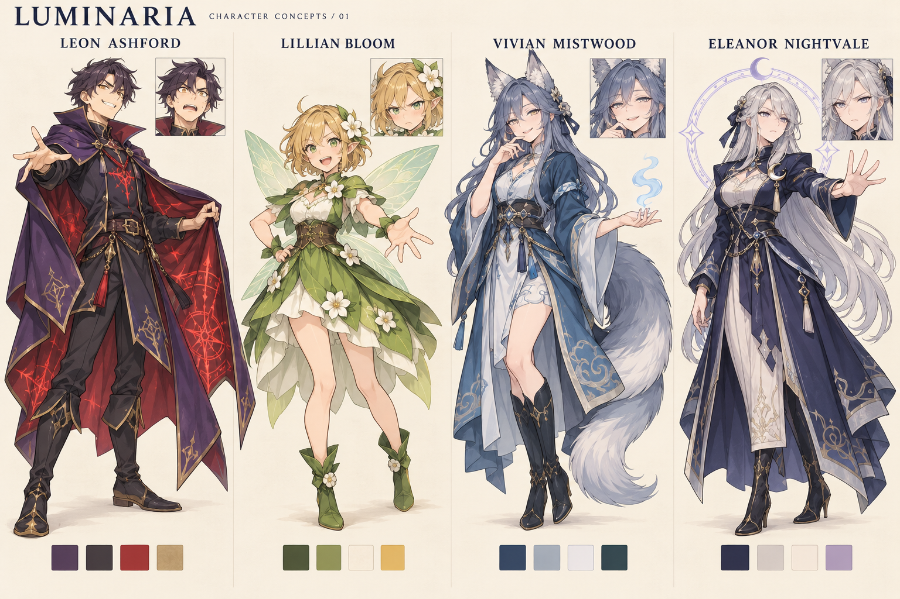

# 캐릭터 디자인 1차 시안

- 기준 문서: [게임 기획서](../게임기획서.md), [리소스 계획서](../리소스계획서.md)
- 제작일: 2026-10-22
- 범위: 주요 캐릭터 4명의 외형과 인상을 비교하는 콘셉트 아트
- 상태: 검토용 제안. 전투 스프라이트·애니메이션·대사용 초상화의 완성본과 구분한다.

## 공통 방향

선명한 선과 간결한 명암을 사용하는 애니메이션풍 판타지로 제안한다. 서양 동화풍 의상 안에서 꽃·여우·달이라는 종족별 특징을 구분한다. 레온의 허세와 수호자들의 반응은 표정과 자세로 보여준다.

기획서에 정해진 이름·역할·대표색·종족 특징은 유지한다. 체형, 은발로 명시된 엘레노어 외의 머리색, 의상 재단, 세부 장식과 표정은 이번 시안에서 새롭게 제안하는 요소다. 세 수호자는 모두 성인으로 표현한다.

색과 함께 큰 외곽 형태를 구분한다. 레온은 각진 망토, 릴리안은 꽃잎 치마와 작은 날개, 비비안은 길게 휘는 꼬리, 엘레노어는 긴 은발과 원형 결계가 핵심이다.

## 레온 애쉬포드 / Leon Ashford

- 기획서 기준: 플레이어·이세계 전생자. 보라색 망토, 붉은 마력 문양, 허세와 야심이 많은 마법사.
- 외형 제안: 짧고 헝클어진 짙은 자주빛 흑발, 호박색 눈, 높은 옷깃과 비대칭 끝단의 보라색 망토.
- 의상 제안: 어두운 마법사 상의와 바지, 가죽 부츠. 가슴과 망토 안쪽에 붉은 마력 문양을 모은다.
- 인상: 눈썹을 치켜든 자신만만한 미소. 망토를 펼치는 과장된 자세로 자칭 최종 보스의 허세를 표현한다.
- 보조 표정: 상대가 자신을 무시했을 때의 당황과 발끈함.
- 작은 이미지에 남길 특징: 보라 망토의 삼각형 외곽과 가슴의 붉은 점.

## 릴리안 블룸 / Lillian Bloom

- 기획서 기준: 1스테이지 보스·꽃요정. 녹색 의상, 꽃 장식, 작은 날개. 밝고 직설적인 숲의 수호자.
- 외형 제안: 작은 성인 체형, 꿀빛 금발 단발, 녹색 눈, 귀 옆의 큰 흰 꽃 한 송이.
- 의상 제안: 잎사귀를 닮은 녹색 겹치마, 짧은 꽃잎형 어깨 망토, 부드러운 녹색 부츠.
- 인상: 한 손을 허리에 얹고 침입자를 꾸짖는 당당한 자세. 밝은 표정 안에서도 보호자로서의 의지가 보이게 한다.
- 보조 표정: 레온의 허세에 솔직하게 짜증 내는 얼굴.
- 작은 이미지에 남길 특징: 초록 꽃잎 치마, 흰 꽃, 몸 양옆의 작은 날개.

## 비비안 미스트우드 / Vivian Mistwood

- 기획서 기준: 2스테이지 보스·여우 요괴. 푸른 의상, 여우 귀와 꼬리, 안개 장식. 침착하고 장난스러운 호수의 수호자.
- 외형 제안: 청회색 긴 머리, 분명한 여우 귀, 끝이 옅은 은색인 큰 꼬리 한 개.
- 의상 제안: 푸른 겹 로브와 밝은 속옷, 길게 흐르는 소매 끝단, 안개를 닮은 단순한 무늬.
- 인상: 몸의 힘을 빼고 살짝 웃으며 상대를 놀리는 자세. 안개 효과는 손 근처에 작게 배치한다.
- 보조 표정: 눈을 반쯤 감은 능청스러운 미소.
- 작은 이미지에 남길 특징: 두 귀와 S자로 휘는 꼬리. 안개 효과가 몸과 탄환을 가리지 않게 한다.

## 엘레노어 나이트베일 / Eleanor Nightvale

- 기획서 기준: 3스테이지 보스·결계 요괴. 은색 머리, 남색 의상, 달과 마법진 장식. 마지막 결계를 지키는 책임감 강한 수호자.
- 외형 제안: 길게 흐르는 은발, 차분한 회보라색 눈, 곧고 긴 외곽 형태.
- 의상 제안: 남색 의식용 드레스 코트, 은색 테두리, 초승달 브로치와 단순한 기하학 결계 무늬.
- 인상: 손바닥을 펴서 침입자를 막는 자세. 진지하고 절제된 표정으로 마지막 수호자의 무게를 보여준다.
- 보조 표정: 결계를 지키려는 단호한 집중.
- 작은 이미지에 남길 특징: 은발과 남색 의상의 대비, 초승달, 몸 뒤의 얇은 원형 결계.

## 게임용 이미지로 옮길 때

| 캐릭터 | 기존 계획의 셀 크기 | 기존 계획의 시트 구성 | 디자인에서 우선 유지할 요소 |
|---|---|---|---|
| 레온 | 32 × 48 px | 4열 × 3행, 128 × 144 px | 망토, 붉은 문양, 이동 시 기울기 |
| 릴리안 | 64 × 64 px | 4열 × 2행, 256 × 128 px | 꽃, 녹색 치마, 작은 날개 |
| 비비안 | 64 × 64 px | 4열 × 2행, 256 × 128 px | 귀, 푸른 의상, 꼬리 |
| 엘레노어 | 64 × 64 px | 4열 × 2행, 256 × 128 px | 은발, 남색 의상, 달 장식 |

- 이 콘셉트 보드는 의상과 인상을 정하는 참고 자료다. 그대로 잘라서 전투용 시트로 사용하지 않는다.
- 전투용 그림은 원래 계획의 셀 크기 안에서 세부 장식을 줄이고, 프레임별 위치와 크기를 맞춰 별도로 제작한다.
- 대사 초상화에서는 얼굴, 상반신, 대표 장식을 우선한다.
- 전투용 PNG는 투명 배경과 셀 내부 여백을 확보한다. 충돌 판정은 그림의 크기와 분리한다.
- 숲·호수·신전의 배경 위에서 외곽과 탄환이 구별되는지 확인한다. 특히 녹색 릴리안과 숲, 푸른 비비안과 호수의 대비를 확인한다.
- 이번 작업은 콘셉트 디자인이다. 기존 리소스 계획서의 스프라이트·초상화 확보 상태는 변경하지 않는다.

## 제작 기록

- 제작 도구: OpenAI 내장 image_gen, imagegen 스킬의 기본 생성 방식
- 원본 설정: 이 프로젝트의 게임 기획서
- 외부 참고 이미지: 사용하지 않음
- 생성 요청문: [character_lineup_v01.prompt.txt](character_lineup_v01.prompt.txt)
- 이미지 파일: [character_lineup_v01.png](character_lineup_v01.png)
- 후편집: 없음. 생성된 원본을 프로젝트에 복사해 보관한다.

