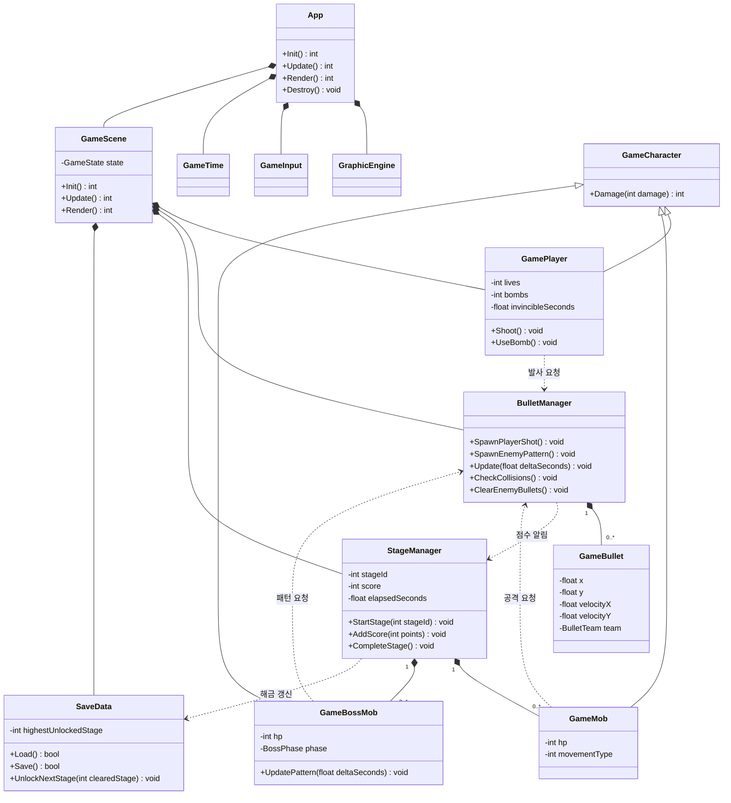
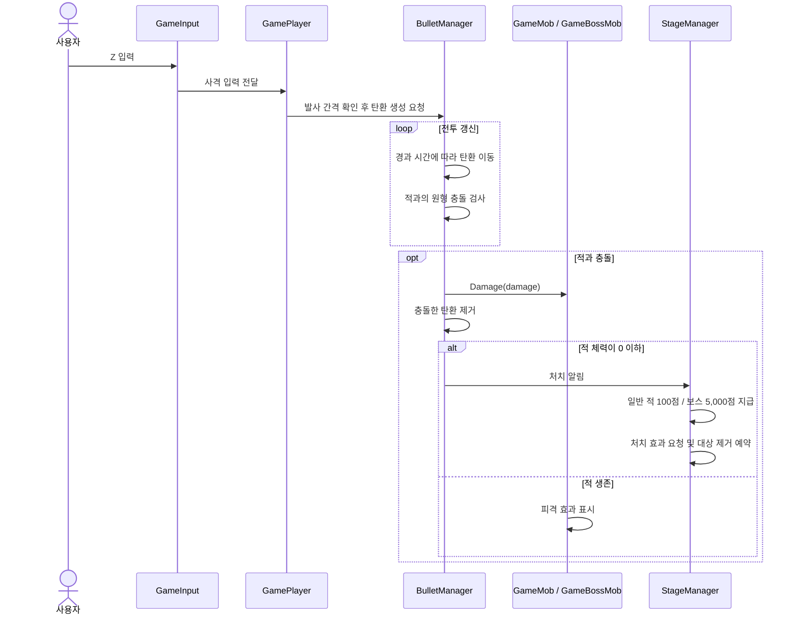
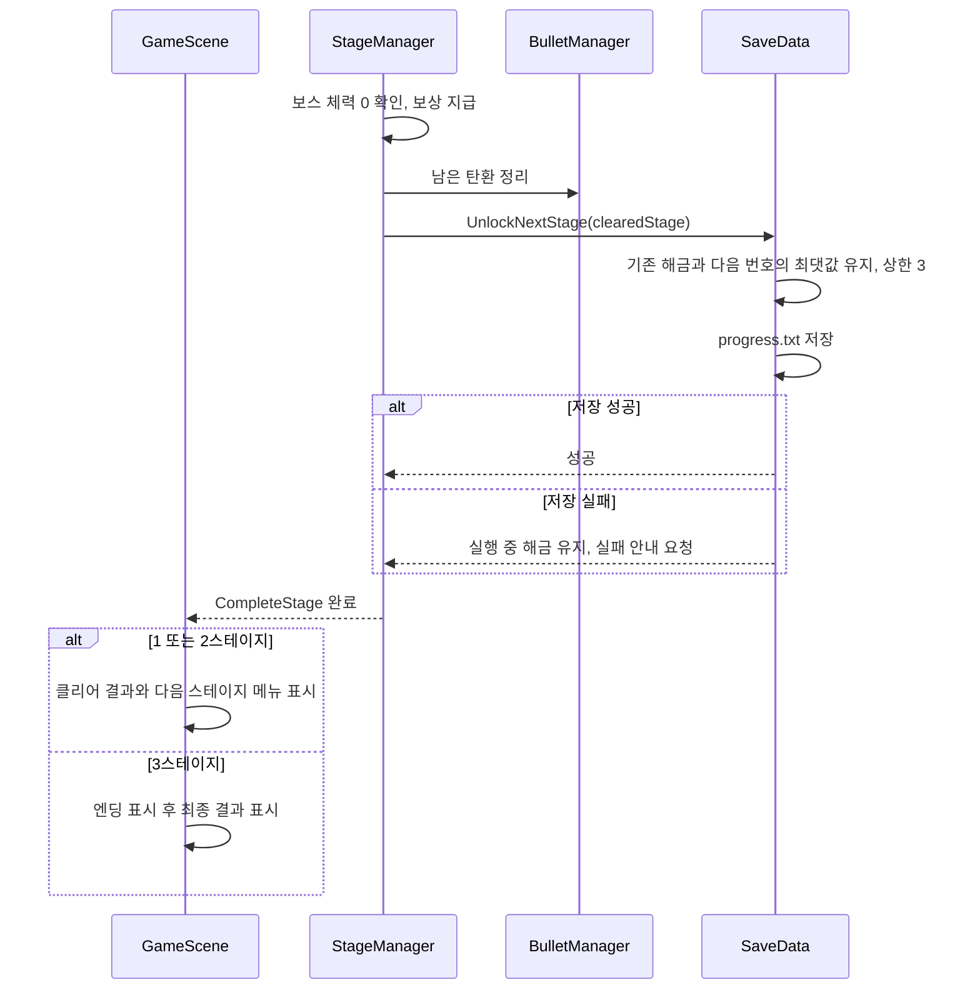

# 이세계에 전생했더니 요정과 요괴들의 최종 보스가 되었습니다 게임 기획서

- 작성자: 문성윤
- 작성일: 2026.10.15
- 수정일1: 2026.10.18
- 수정일2:

# 개요

- 게임 이름: 이세계에 전생했더니 요정과 요괴들의 최종 보스가 되었습니다
- 장르: 2D 세로 스크롤 탄막 슈팅 게임
- 플레이 인원: 1명
- 개발 환경: Visual Studio 2022, C++20, glc2d
- 실행 환경: Windows PC, 키보드 조작
- 화면 크기: 960 × 600, 창 모드
- 플레이 시간: 3개 스테이지를 처음부터 클리어하는 데 약 10분
- 게임 목적: 침략자인 주인공을 조작하여 요정과 요괴의 방어선을 돌파하고 세 결계를 점령한다.
- 기획 의도: 동방풍의 화려한 탄막과 패턴 회피를 바탕으로, 플레이어가 수호자들의 입장에서 최종 보스가 되는 이야기를 만든다. 캐릭터, 세계관, 대사와 리소스는 독자적으로 구성한다.

### 스토리

주인공 레온 애쉬포드는 이세계에 전생하면서 강력한 마력을 얻는다. 그는 새로운 삶에서는 일을 하지 않고 편하게 살겠다는 생각으로, 요정과 요괴들이 살아가는 루미나리아를 자신의 영지로 삼으려 한다.

그러나 루미나리아의 주민들에게 레온은 평화로운 고향을 빼앗으러 온 침략자다. 꽃요정 릴리안 블룸, 여우 요괴 비비안 미스트우드, 결계 요괴 엘레노어 나이트베일은 각자의 영역에서 그를 막아선다.

레온은 스스로를 위대한 지배자라고 소개하지만, 수호자들은 그를 무례한 불청객으로 취급한다. 전투 전후의 짧은 대사로 레온의 허세와 수호자들의 반응을 보여준다.

세 결계를 모두 점령하면 레온은 루미나리아의 지배자가 된다. 하지만 왕좌에는 요정들이 장난을 쳐 놓고, 요괴들은 매일 항의하러 찾아온다. 레온이 꿈꾸던 편안한 생활과는 거리가 먼 모습을 보여주며 끝난다.

### 구현 범위 및 개발 계획

- 플레이어 캐릭터 1명, 일반 적 3종, 보스 3명을 구현한다.
- 스테이지는 총 3개이며, 보스마다 서로 다른 공격 패턴 2개를 구현한다.
- 난이도는 하나로 고정하고 스테이지가 진행될수록 탄막 구성을 복잡하게 만든다.
- 타이틀, 조작법, 스테이지 선택, 일시정지, 결과, 엔딩 화면을 구성한다.
- 일반 적 처치와 보스 처치로 점수를 얻는다. 성장, 상점, 장비, 온라인 순위 기능은 구현 범위에서 제외한다.
- 플레이어와 적 이미지, 보스 초상화, 배경 3종, 탄환, 피격·폭발 이미지, 배경 음악과 효과음을 준비한다. 외부 리소스는 출처와 이용 조건을 기록한다.

| 단계 | 주요 개발 내용 | Git Tag |
|---|---|---|
| 1주차 | 프로젝트 생성, 기획서 작성, 기본 화면과 입력·이동 구현 시작 | f1 |
| 2주차 | 주요 리소스 확보, 화면 전환, 플레이어·탄환·일반 적 기본 동작 | f2 |
| 3주차 | 충돌, 생명, 폭탄, 점수, 1스테이지와 보스 전투 | f3 |
| 4주차 | 2·3스테이지, 해금 저장, 애니메이션과 연출 보완 | f4 |
| 최종 | 전체 진행 확인, 난이도 조정, 리소스·문서 정리 | fin |

- 각 단계는 개발 상태를 확인하는 기준으로 사용하며, 문서·리소스 준비와 소스 개발을 함께 진행한다.
- 최종 제출 기준일: 2026.11.30 17:00. 과제 조건은 제공된 「[강의] C++ 기말고사 - 게임제작」의 개발·제출 기준을 참고한다.

# 시스템 기획 내용

---

## 플레이 방식

### 기본 조작

| 키 | 기능 |
|---|---|
| 방향키 | 플레이어 이동, 메뉴 항목 선택 |
| Z | 누르고 있는 동안 일정 간격으로 전방 마력탄 발사 |
| Shift | 누르고 있는 동안 저속 이동, 피격 중심점 표시 |
| X | 폭탄 1개 사용 |
| Enter | 메뉴 선택, 대사 진행 |
| Esc | 전투 중 일시정지, 메뉴에서 이전 화면으로 이동 |

- 플레이어는 전투 영역 안에서 상하좌우로 이동하며 위쪽으로 사격한다.
- 대각선 이동 속도는 가로·세로 이동 속도와 같게 보정한다.
- 캐릭터 그림보다 작은 원형 피격 판정을 사용하고, 저속 이동 중 중심점을 표시하여 좁은 탄막 사이를 통과할 수 있게 한다.
- 화면 밖으로 이동할 수 없으며, 화면을 벗어난 탄환과 일반 적은 제거한다.

### 생명, 폭탄, 점수

- 스테이지 진입, 다음 스테이지 진행, 재도전 시 생명 3개·폭탄 3개·점수 0점으로 초기화한다. 결과 화면에는 해당 스테이지 점수를 표시한다.
- 적탄이나 적 본체에 닿으면 생명 1개를 잃는다. 피격 후 1.5초 동안 무적이며, 깜빡임으로 상태를 표시한다.
- 무적 중에는 추가 피해를 받지 않는다. 생명이 0이 되면 실패 결과 화면으로 이동한다.
- 폭탄은 화면의 적탄을 즉시 제거하고 플레이어에게 1초간 무적을 제공한다. 적 체력에 직접 피해를 주지는 않는다.
- X를 한 번 누를 때 폭탄 1개를 소비한다. 계속 누르고 있어도 연속 소비하지 않으며, 남은 폭탄이 0개이면 사용할 수 없다.
- 피격 무적과 폭탄 무적이 겹치면 남은 시간이 더 긴 쪽을 유지한다.
- 일반 적을 처치하면 100점, 보스를 처치하면 5,000점을 얻는다. 화면 밖으로 퇴장한 적에게는 점수를 지급하지 않는다.
- 탄환은 한 대상에 피해를 준 뒤 제거하며, 처치 점수는 적 1개체당 한 번만 지급한다.

### 진행 및 승패

1. 타이틀에서 게임 시작을 선택한다.
2. 스테이지 선택 화면에서 해금된 스테이지를 선택한다.
3. 짧은 도입 대사 후 일반 적 구간을 진행한다.
4. 일반 적 구간이 끝나면 남은 일반 적을 퇴장시키고 적탄을 정리한 뒤 보스 등장 대사를 보여준다.
5. 보스 체력을 모두 소진하면 클리어한다. 다음 스테이지가 있으면 해금하고 저장한다.
6. 1·2스테이지는 클리어 결과 화면을 표시한다. 3스테이지는 엔딩을 보여준 뒤 최종 결과 화면을 표시한다.

- 보스 체력이 절반 이하가 되면 한 번만 두 번째 패턴으로 전환한다. 전환 시 적탄을 제거하고 보스 체력은 유지한다.
- 보스 체력이 0이 되면 처치 처리를 먼저 수행하고, 두 번째 패턴을 새로 시작하지 않는다.
- 보스 처치와 플레이어의 마지막 피격이 같은 갱신에서 발생하면 클리어를 우선한다.
- 보스전 60~90초는 목표 플레이 시간이며 제한 시간이 아니다. 보스를 처치해야 클리어한다.
- 일시정지·대사·결과 화면에서는 전투 시간, 이동, 공격 주기와 무적 시간이 진행되지 않는다. 재개 시 멈춰 있던 시간이 한꺼번에 반영되지 않도록 한다.

### 스테이지 해금 및 저장

- 처음 실행하면 1스테이지만 선택할 수 있다.
- 1스테이지 클리어 시 2스테이지, 2스테이지 클리어 시 3스테이지를 해금한다. 열린 스테이지는 자유롭게 다시 선택할 수 있다.
- 실행 파일 폴더의 `progress.txt`에 최고 해금 스테이지 번호 1~3을 저장한다. 생명·폭탄·점수·전투 중간 상태는 저장하지 않는다.
- 저장 정보가 없거나 정수 1~3으로 읽을 수 없으면 1스테이지부터 시작한다.
- 재도전, 실패, 이전 스테이지 재클리어로 해금 상태가 낮아지지 않게 한다.
- 저장에 실패하면 이번 실행에서는 해금 상태를 유지하고, 결과 화면에 저장 실패를 안내한다.

### C++20 구현 기준

- Visual Studio 2022의 C++ 언어 표준을 `/std:c++20`으로 지정하는 것을 구현 기준으로 한다.
- 프로젝트 파일에서는 Debug/Release × Win32/x64의 네 구성에 `<LanguageStandard>stdcpp20</LanguageStandard>`를 지정한다.
- 현재 프로젝트에는 언어 표준 항목이 없으므로, 실제 구현 단계에서 설정을 반영하고 Windows에서 확인한다.

| 용도 | 사용 문법 및 자료형 | 적용 방향 |
|---|---|---|
| 객체 목록 | `std::vector` | 일반 적과 탄환 목록 관리 |
| 객체 소유권 | `std::unique_ptr` | 씬과 적·보스 객체의 수명 관리 |
| 상태 구분 | `enum class` | 게임 화면, 보스 단계, 탄환 소속 구분 |
| 시간 관리 | `std::chrono::steady_clock` | 프레임 사이 경과 시간 측정 |
| 탄막 각도 | `std::numbers::pi_v<float>` | 원형·부채꼴·회전 탄막 계산 |
| 공통 상수 | `constexpr` | 초기 생명, 폭탄, 점수 기준 정의 |

- 위 기능 중 `std::numbers`는 C++20에서 추가된 기능이다. 나머지 기능도 C++20 기준 설계 안에서 함께 활용한다.
- 이동량은 초 단위 경과 시간에 비례하게 계산한다. 현재 `GameTime::deltaTime`은 밀리초 단위이므로 초로 변환하는 기준을 통일한다.
- 기존 `Attack(GameCharacter*, int)`는 대상을 직접 지정해 피해를 주는 초기 구조다. 슈팅 전투에서는 발사 시 탄환을 생성하고, 이후 충돌할 때 피해를 주는 흐름으로 확장한다.
- 아래는 원형 탄막 계산을 설명하는 C++20 구현 예시이며, 현재 소스에 반영된 코드는 아니다.

```cpp
#include <cmath>
#include <numbers>
#include <vector>

struct BulletSpawn
{
    float x{};
    float y{};
    float velocityX{};
    float velocityY{};
};

std::vector<BulletSpawn> MakeRing(
    float x, float y, float speed, int count)
{
    std::vector<BulletSpawn> bullets;
    if (count <= 0)
        return bullets;

    constexpr float fullTurn = 2.0f * std::numbers::pi_v<float>;
    for (int i = 0; i < count; ++i)
    {
        const float angle = fullTurn * static_cast<float>(i)
                            / static_cast<float>(count);
        bullets.push_back({x, y,
                           std::cos(angle) * speed,
                           std::sin(angle) * speed});
    }
    return bullets;
}
```

## 스테이지 구성

| 스테이지 | 배경 | 일반 적 구간 | 보스 |
|---|---|---|---|
| 1. 꽃빛 요정의 숲 | 꽃과 빛이 흐르는 숲 | 직선 이동하는 순찰 요정과 느린 단발탄 | 릴리안 블룸 |
| 2. 안개 요괴의 호수 | 안개가 흐르는 호수 | 좌우 이동하는 안개 사역마와 조준탄 | 비비안 미스트우드 |
| 3. 월광의 결계 신전 | 달빛과 마법진이 떠 있는 신전 | 결계 수호령을 포함해 앞선 적 유형을 조합 | 엘레노어 나이트베일 |

- 각 스테이지는 일반 적 구간 약 90초와 보스전 약 60~90초를 목표로 한다. 대사와 결과 확인을 포함하여 전체 약 10분으로 조정한다.
- 1스테이지에서는 이동·사격·저속 회피를 익히게 한다. 적은 간격을 두고 등장하고 탄 사이에 넓은 통로를 둔다.
- 2스테이지에서는 플레이어의 위치를 노리는 공격과 양쪽에서 들어오는 탄을 섞어 이동 방향을 판단하게 한다.
- 3스테이지에서는 회전하는 탄막과 고리의 빈틈을 읽게 한다. 예고 없이 플레이어 바로 위에 탄을 생성하지 않고 회피 경로를 남긴다.
- 배경은 아래 방향으로 스크롤하여 주인공이 수호자들의 영역 안쪽으로 진입하는 느낌을 준다.

| 일반 적 | 기본 행동 | 공격 |
|---|---|---|
| 순찰 요정 | 화면 위에서 아래로 이동 | 아래 방향으로 느린 단발탄 발사 |
| 안개 사역마 | 좌우로 움직이며 하강 | 발사 시점의 플레이어 위치를 겨냥한 탄 발사 |
| 결계 수호령 | 정해진 위치에 잠시 머문 뒤 퇴장 | 간격을 둔 소규모 부채꼴 탄막 발사 |

## 캐릭터 모델

| 캐릭터 | 역할·종족 | 외형 방향 | 성격 및 목적 |
|---|---|---|---|
| 레온 애쉬포드 / Leon Ashford | 플레이어·이세계 전생자 | 보라색 망토와 붉은 마력 문양을 가진 마법사 | 허세와 야심이 많으며 편한 생활을 위해 남의 세계를 점령하려 한다. |
| 릴리안 블룸 / Lillian Bloom | 1스테이지 보스·꽃요정 | 녹색 의상, 꽃 장식, 작은 날개 | 밝고 직설적이며 숲과 작은 요정들을 보호한다. |
| 비비안 미스트우드 / Vivian Mistwood | 2스테이지 보스·여우 요괴 | 푸른 의상, 여우 귀와 꼬리, 안개 장식 | 침착하고 장난스러우며 침략자를 호수에서 막아낸다. |
| 엘레노어 나이트베일 / Eleanor Nightvale | 3스테이지 보스·결계 요괴 | 은색 머리, 남색 의상, 달과 마법진 장식 | 책임감이 강하며 세계를 보호하는 마지막 결계를 지킨다. |

- 전투용 작은 캐릭터 이미지와 대사 화면용 초상화를 구분한다.
- 플레이어는 기본·좌우 이동·피격 상태를 표현하고, 일반 적과 보스는 이동·공격·처치 상태를 표현한다.
- 요정의 녹색, 호수의 파란색, 신전의 남색 배경 위에서 탄이 구별되도록 탄환에 밝은 외곽선을 사용한다.

### 주요 대사 예시

- 레온: "이 숲, 오늘부터 내 영지로 하겠다!"
- 릴리안: "남의 집에 들어오자마자 무슨 소리예요?"
- 비비안: "왕관보다 먼저 길 찾는 법부터 배워야겠네."
- 엘레노어: "이곳은 네가 편하게 살기 위해 빼앗아도 되는 세계가 아니다."
- 엔딩의 레온: "세계를 정복했는데 왜 할 일이 더 많아진 거지?"

## ui 구성

### 화면 배치

- 전투 화면은 왼쪽 480 × 600의 세로형 전투 영역과 오른쪽 정보 패널로 나눈다.
- 정보 패널에는 게임 이름, 스테이지 이름, 점수, 남은 생명, 폭탄, 조작 안내와 캐릭터 초상화를 표시한다.
- 긴 게임 이름은 타이틀에서 여러 줄로 배치하고, 전투 중에는 짧게 "요정과 요괴들의 최종 보스"로 표시한다.
- 보스 체력과 현재 패턴 이름은 전투 영역 상단에 표시한다.
- 대사는 전투를 멈춘 상태에서 화면 하단 대사창과 초상화로 보여준다.

### 메뉴 및 화면 전환

| 화면 | 표시 및 선택 내용 |
|---|---|
| 타이틀 | 게임 시작, 조작법, 종료 |
| 조작법 | 키 설명, 피격 중심점, 폭탄과 해금 규칙 |
| 스테이지 선택 | 1~3스테이지 이름·보스·해금 여부, 잠긴 항목의 해금 조건 |
| 일시정지 | 계속하기, 재도전, 스테이지 선택, 타이틀로 |
| 클리어 결과 | 점수, 다음 스테이지, 재도전, 스테이지 선택 |
| 실패 결과 | 점수, 재도전, 스테이지 선택 |
| 엔딩 | 점령 성공 이야기, 수호자들의 장난과 항의, Enter로 최종 결과 이동 |
| 최종 결과 | 3스테이지 점수, 재도전, 스테이지 선택, 타이틀로 |

- 잠긴 스테이지를 선택하면 전투로 이동하지 않고 해금 조건을 표시한다.
- 조작법·스테이지 선택에서 Esc를 누르면 타이틀로 돌아간다.
- 일시정지에서 Esc 또는 계속하기를 선택하면 전투를 재개한다.
- 일시정지에서 재도전하면 현재 스테이지를 처음부터 다시 시작한다. 스테이지 선택·타이틀로 돌아가면 현재 전투를 종료한다.
- 결과·엔딩 화면에서는 Enter로 안내된 항목을 선택하거나 진행한다. 전투에 사용한 Z·X 입력이 메뉴 선택으로 이어지지 않게 한다.

### 동적 표현

- 시간에 따라 배경을 스크롤하고 일반 적이 정해진 경로로 이동한다.
- 캐릭터 이동과 공격, 탄환 이동, 보스 패턴 전환을 시간에 따라 표현한다.
- 피격 깜빡임, 적 처치 폭발, 폭탄 사용 효과, 보스 등장·퇴장 효과를 넣는다.
- 탄환이 밀집해도 피격 중심점과 회피할 틈을 식별할 수 있게 효과의 크기와 밝기를 조절한다.

## 주요 클래스 다이어그램

### 현재 구현 상태

- `App`, `GraphicEngine`, `GameTime`, `GameInput`, `GameScene`의 기본 틀이 있다. 현재 씬은 텍스트를 표시하는 초기 상태다.
- `GameCharacter`를 상속하는 `GamePlayer`, `GameMob`, `GameBossMob`이 있다. 탄환·보스 패턴·스테이지 해금 기능은 추가 구현 대상이다.
- 아래 다이어그램의 소유 관계와 추가 멤버·메서드는 목표 설계다. 현재 소스에 모두 구현되어 있다는 의미는 아니다.



- `GameState`는 타이틀·조작법·선택·대사·전투·일시정지·결과·엔딩을, `BossPhase`는 1·2단계를, `BulletTeam`은 플레이어·적 소속을 구분하는 `enum class`로 설계한다.
- `BulletManager`는 `std::vector<GameBullet>`로 탄환을 관리한다. 플레이어 탄은 적에게, 적탄은 플레이어에게만 충돌하게 한다.
- `StageManager`는 `std::vector<std::unique_ptr<GameMob>>`와 `std::unique_ptr<GameBossMob>`로 적을 소유한다. 다른 객체의 참조는 소유권을 넘기지 않는다.
- 스테이지를 종료하거나 재시작할 때 기존 적과 탄환을 정리하고 경과 시간·점수·플레이어 상태를 초기화한다.

## 주요 시퀀스 다이어그램

### 공격과 보상



- 적과 탄환은 순회 중 즉시 지우지 않고 제거 표시를 남긴 뒤 정리하여 반복자 무효화를 방지한다.
- 이미 처치 표시된 적은 추가 피해와 점수 지급 대상에서 제외한다.
- 보스 처치 시 점수 지급과 별도로 스테이지 완료 처리를 한 번 수행한다.

### 스테이지 클리어와 해금



### 구현 및 실행 확인

- 문서 확인: 기존 목차 순서, 캐릭터 이름, 게임 수치, 표·링크·Mermaid 문법이 일치하는지 확인한다.
- C++20 설정: Windows에서 네 프로젝트 구성의 C++ 언어 표준과 코드 예시·소스의 컴파일 여부를 확인한다.
- 해금: 첫 실행에서 1스테이지만 열리는지, 잠긴 항목의 진입이 차단되는지, 클리어 후 다음 스테이지가 열리는지 확인한다.
- 저장: 재실행 시 해금 유지, 저장 파일 누락·잘못된 값의 초기화, 저장 실패 안내와 실행 중 해금 유지를 확인한다.
- 재도전: 적·탄환·시간·점수 정리와 생명 3개·폭탄 3개 복원을 확인한다. 해금 상태는 유지되어야 한다.
- 피격: 한 번에 생명 1개만 감소하고 1.5초 무적이 적용되는지, 생명 0에서 실패하는지 확인한다.
- 폭탄: X 한 번에 1개만 소비하고, 적탄 소거·1초 무적·0개일 때 사용 차단이 동작하는지 확인한다.
- 정지와 재개: 일시정지·대사 중 전투가 멈추고, 재개할 때 탄환이나 공격 시간이 갑자기 진행되지 않는지 확인한다.
- 보스와 점수: 체력 절반에서 패턴이 한 번 전환되고, 처치 보상이 중복 지급되지 않으며, 동시 피격 시 클리어 우선 규칙이 적용되는지 확인한다.
- 최종 진행: 1→2→3스테이지, 엔딩, 최종 결과, 재도전·메뉴 복귀를 확인한다. 전체 목표 시간과 탄막 회피 가능 여부를 플레이하며 조정한다.
- 검증 환경: 현재 작업 환경은 Arch Linux다. Visual Studio 컴파일과 Windows 실행, 화면·입력·사운드 확인은 사용자가 수행한다. 이 목록은 구현 후 확인할 항목이며 실행 검증 완료를 의미하지 않는다.

## Boss Mob 클래스 구성

### 공통 구성

- 기존 `GameBossMob : public GameCharacter`를 확장하고 보스 종류별 설정으로 체력·이동·공격 주기·패턴을 구분한다.
- 주요 데이터: 보스 종류, 현재·최대 체력, 위치, 이동 목표, 현재 단계, 공격 누적 시간, 등장·전투·처치 상태.
- 주요 처리: 등장, 위치 이동, 패턴 갱신, 탄환 생성 요청, 피해 처리, 단계 전환, 처치 알림.
- `UpdatePattern(float deltaSeconds)`에서 경과 시간에 따라 공격을 요청하고, 실제 탄환 생성·이동·충돌은 `BulletManager`가 관리한다.
- 1단계는 체력 50% 초과, 2단계는 체력 50% 이하에서 사용한다. 등장·처치 연출 중에는 새 공격을 생성하지 않는다.
- 보스 종류는 `enum class BossType`으로 구분한다. 별도 보스 클래스 세 개를 만드는 대신 공통 클래스에서 설정과 패턴 함수를 선택한다.

### 보스별 패턴

| 보스 | 1단계 | 2단계 | 회피 방향 |
|---|---|---|---|
| 릴리안 블룸 | 꽃잎 부채: 아래쪽으로 넓은 간격의 부채꼴 탄 발사 | 만개: 일정 간격으로 원형 확산탄 발사 | 탄 사이의 넓은 틈으로 이동하며 기본 회피를 익힌다. |
| 비비안 미스트우드 | 안개 추적: 발사 순간의 플레이어 위치를 겨냥한 탄 묶음 발사 | 거울 안개: 좌우 발사점에서 교차하는 탄 발사 | 조준을 유도한 뒤 이동하고 교차 지점을 피한다. |
| 엘레노어 나이트베일 | 월광 나선: 발사 각도를 조금씩 바꾸는 회전 탄막 | 최후의 결계: 한 구간을 비워 둔 고리 탄막을 반복 발사 | 회전 방향을 읽고 고리의 빈틈으로 이동한다. |

- 조준탄은 발사 후 플레이어를 계속 추적하지 않는다.
- 최후의 결계는 매번 통과할 수 있는 빈 구간을 남기고, 다음 고리까지 이동할 시간을 확보한다.
- 보스의 체력·탄속·발사 간격은 Windows 플레이 테스트로 조정하여 목표 시간과 회피 가능한 난이도를 맞춘다.
